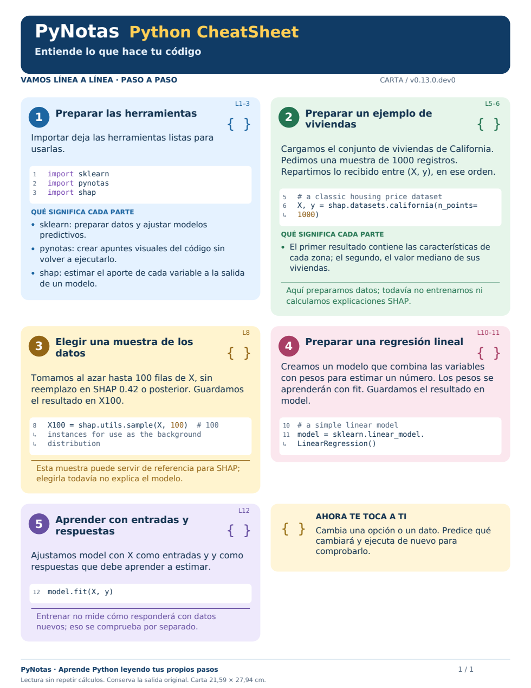

# PyNotas

**Tu código, explicado paso a paso.** Biblioteca pedagógica abierta en español.

PyNotas convierte código Python en apuntes visuales en español para acompañar el
aprendizaje. Puedes usarla con código escrito por ti o generado con ayuda de un LLM.
Identifica operaciones conocidas, explica sus pasos y parámetros y organiza las
notas en láminas descargables. Funciona mediante análisis estático y plantillas:
no necesita un LLM ni una API, y no vuelve a ejecutar tu código.



## Estado del desarrollo

La versión pública estable es 0.12.0. Esta rama prepara **0.13.0.dev0**, con
explicaciones más concretas para SHAP, Keras, PyTorch y modelos de scikit-learn.
No se ha publicado esta versión de desarrollo en PyPI. Instalar desde PyPI
todavía no incluye estos cambios.

Por ejemplo, `model.fit(X, y)` explica que `X` contiene las entradas y `y` las
respuestas que el modelo aprende a estimar. `shap.utils.sample(X, 100)` explica
que selecciona filas para una muestra, y que eso aún no calcula valores SHAP.
Consulta la [cobertura y límites](docs/EXPLICACIONES.md).

## En Google Colab o Jupyter

```python
%pip install pynotas
```

En una nueva celda:

```python
import pynotas
```

Ejecuta después una celda de Python. La salida original permanece visible y las
notas aparecen plegadas en **Ver explicación de PyNotas**. Puedes abrirlas,
descargarlas como PDF o JPG y volver a ocultarlas. Se pliegan las notas, no la
celda completa ni sus resultados. Si actualizas una biblioteca ya importada,
reinicia la sesión antes de volver a importarla.

## Opciones

```python
pynotas.activar(oculto=True)           # Notas plegadas al terminar cada celda.
pynotas.activar(capturar_graficos=False)
pynotas.desactivar()
pynotas.activar()
print(pynotas.__version__)
```

No hace falta indicar un contexto para comenzar. `contexto="vibraciones"` y otras
opciones del motor se conservan. Para omitir una celda, incluye `# pynotas: omitir`.
`PYNOTAS_AUTOACTIVAR=0` desactiva el inicio automático antes del primer import.

Fuera de un notebook puedes generar apuntes sin ejecutar el código:

```python
import pynotas
pynotas.guardar("temperaturas = [60, 65, 70, 75]\npromedio = sum(temperaturas) / len(temperaturas)", "apuntes.html")
```

También existe `python -m pynotas archivo.py`.

## Alcance pedagógico

La explicación es una lectura de la sintaxis y de patrones reconocidos; no es
una validación de la corrección del programa ni de sus resultados. Las funciones
desconocidas reciben una explicación general. El objetivo es apoyar el estudio,
la práctica y las preguntas al docente, no sustituirlos ni garantizar aprendizaje.

Los gráficos PNG/JPEG ya publicados por la celda pueden incorporarse sin repetir
los cálculos. No se capturan tablas HTML ni gráficos interactivos que solo emitan
HTML. Las hojas son tamaño carta; los códigos extensos pueden ocupar varias hojas.
Los límites del motor y de captura se mantienen respecto de SURF IA 0.11.0.

## Transición desde SURF IA

La biblioteca antes se distribuía como `surfia-pedagogia` y se importaba con
`import surfia`. El nuevo nombre es `pynotas` en ambos casos. El paquete de
compatibilidad `surfia-pedagogia==0.12.0` depende de PyNotas 0.12.0 y conserva
los imports anteriores. No contiene una segunda copia del motor.

Para actualizar una clase existente tras publicar ambos paquetes:

```python
%pip install --upgrade "surfia-pedagogia==0.12.0"
```

Reinicia la sesión. Los notebooks anteriores pueden seguir usando `import surfia`.
Para nuevos materiales, usa `import pynotas`.

## Licencia

[MIT](LICENSE): puedes usar, estudiar, modificar y redistribuir PyNotas, también
con fines comerciales, conservando los avisos de licencia y autoría.
Las fuentes tipográficas incluidas conservan [su propia licencia](src/pynotas/fonts/LICENSE_DEJAVU).

## Mejorarlo en comunidad

Puedes proponer reglas, mejorar las explicaciones, informar errores y aportar
ejemplos. Consulta [cómo contribuir](CONTRIBUTING.md). No hace falta implementar
una función para ayudar: una celda mínima y una explicación de por qué la nota
no se entiende son aportes valiosos.

Para probar esta rama desde una copia local:

```sh
python -m pip install -e '.[dev]' -e ./compat
python -m unittest discover -s tests -v
```

El directorio `compat/` conserva el puente para los imports antiguos; el motor
vive únicamente en `src/pynotas/`.
